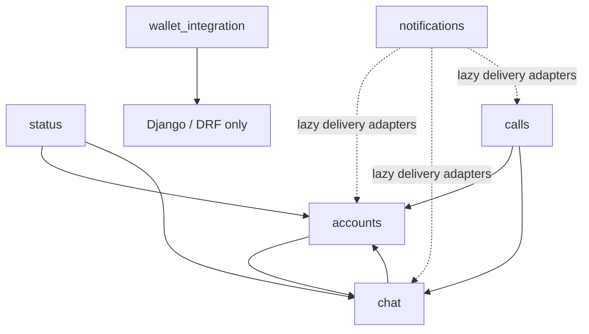

# Module Dependency Map

This map is based on current Python imports and source-level calls in `apps/`, plus React imports in `frontend/src/`. Test and migration imports are excluded from the runtime dependency description.

## Django capability graph

The `accounts ↔ chat` capability relationship is required today: accounts supports saving a participant from a private chat, while chat uses account identity/privacy. The remaining accounts-to-chat calls in account views are imported inside request methods. `status` depends on account contacts and chat membership/message behavior. Calls persist a relation to `ChatRoom` and check chat membership. Notifications uses late imports to deliver chat/call/account events. These direct calls are intentional monolith seams, not separate network services.

The source-level check added in `apps/chat/tests/test_architecture_boundaries.py` builds a graph from top-level cross-app imports. That graph must remain acyclic. It also checks that Wallet Integration does not import another product app and that the status reply service does not import HTTP views.

## Frontend dependency shape

- `components/layout/MainLayout.jsx` composes section screens and lazy-loads `features/wallet`.
- `features/wallet/WalletPanel.jsx` owns Wallet screen presentation.
- `features/wallet/api.js` owns Wallet endpoint calls and delegates transport/authentication to `api/client.js`.
- Chat, calls, contacts, status, and assistant remain in their existing component directories; they have not been bulk-moved.
- A file-level import graph audit found no React source-file import cycles at this baseline. Directory-level mutual usage is not itself a file import cycle.

## Known integration seams

- `apps/calls/group.py` and `apps/calls/lifecycle.py` coordinate group call scheduling and timeout behavior with function-local imports. This keeps imports deferred but remains an internal service cycle that deserves a focused future seam cleanup and tests.
- Chat and Status call each other's capabilities for status replies/cards and shared chat data. Status visibility policy no longer calls into a view class.
- Account deletion calls chat/status cleanup services. This is a lifecycle orchestration concern and must retain its transaction and notification semantics.
- `apps/notifications/push.py` dispatches across account, chat, and calls; it is a shared delivery adapter, not an owner of those domains.

## Shared infrastructure

`config/settings/` owns app setup and security configuration; `config/urls.py` owns HTTP mounting; `config/routing.py` and consumers own WebSocket routing; `frontend/src/api/client.js`, `src/services/realtime.js`, and `src/store/` are existing shared frontend infrastructure.
